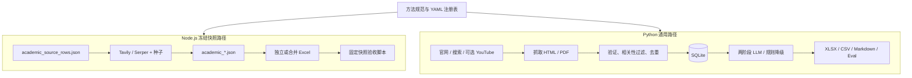

# AI-Tech-Intelligence

面向高校、研究机构与技术研究者的**证据约束型 AI 技术情报流水线**。项目以 `executive-intelligence` Skill 为方法规范，将实体注册、官方来源发现、来源摘要、量化趋势研判、跨实体去重、Excel 导出和交付前校验拆分为可审计的独立阶段。

本项目在明确证据边界的前提下回答：

- 哪些机构或研究者正在公开讨论、研究或交付某项 AI 技术？
- 当前判断来自官网、官方代码仓库、个人主页，还是仅来自注册表说明？
- 趋势判断的时间窗口、主观概率、领先指标和证伪条件是什么？
- 哪些结论证据不足、彼此过于相似，或需要人工阅读全文复核？
- 最终交付物能否追溯到来源、分析模型和质量检查结果？

> 当前仓库是一份以 **2026-09-22 / 2026-09-23** 为数据快照日期的实现。部分文件名、日期、查询年份和验收行数写在脚本中；用于新的周期性任务前，请先阅读[已知限制与改造建议](#已知限制与改造建议)。

## 概述

仓库中存在两条执行路径。当前主要维护对象是 **Node.js 高校/研究机构快照流水线**；`src/ai_tech_intelligence/` 下的 **Python 通用流水线**功能更完整，但当前配置和部分测试仍处于迁移状态。两条路径都需要先处理下述版本漂移，才能形成新的正式交付。

| 路径 | 适用场景 | 主入口 | 数据落点 | 当前状态 |
| --- | --- | --- | --- | --- |
| Node.js 快照流水线 | 复现 2026-09 高校、研究机构和研究者交付物 | `npm.cmd run ...`、`scripts/*.mjs` | `data/academic_*.json`、`outputs/*.xlsx` | 主路径；基础五页契约通过，当前代码新增页需重新导出 |
| Python 通用流水线 | 持续采集网页/PDF、写入 SQLite、按文档分析和导出报告 | `python main.py ...` / `ai-tech-intel ...` | `data/intelligence.db`、`outputs/ai_executive_intelligence_*` | 实现已存在但本机未实跑；当前注册表与旧厂商测试不一致 |
| 模板合并路径 | 把高校情报合并进历史“高管/厂商情报”工作簿 | `merge_academic_into_template.mjs` | 合并版 XLSX、HTML 预览 | 现存合并文件较旧，须重新生成后再验收 |

先执行 `npm.cmd ci` 和 `npm.cmd run verify:academic` 验证冻结交付物，再决定是继续维护快照脚本，还是将业务迁移到 Python + SQLite 主干。若要开始新周期，优先完成日期/路径参数化和统一实体注册表，不要直接覆盖 2026-09 的历史 JSON。

## 目录

- [概述]
- [当前仓库验证状态](#当前仓库验证状态)
- [Skill 的核心原则](#skill-的核心原则)
- [工作流与系统边界](#工作流与系统边界)
- [当前数据快照](#当前数据快照)
- [项目结构](#项目结构)
- [环境要求](#环境要求)
- [快速开始](#快速开始)
- [Python 通用流水线](#python-通用流水线)
- [配置说明](#配置说明)
- [各阶段详细说明](#各阶段详细说明)
- [数据结构与字段口径](#数据结构与字段口径)
- [Excel 交付物](#excel-交付物)
- [质量门禁](#质量门禁)
- [断点续跑与小规模调试](#断点续跑与小规模调试)
- [扩展实体和来源](#扩展实体和来源)
- [安全与合规](#安全与合规)
- [已知限制与改造建议](#已知限制与改造建议)
- [常见问题](#常见问题)

## 当前仓库验证状态

以下结果为 **2026-10-19** 在当前工作副本中的实际检查，不等同于未来重新采集后的结果。

| 检查项 | 结果 | 说明 |
| --- | --- | --- |
| Git 工作区 | 通过 | 修改 README 前工作区无未提交变更 |
| Node.js 脚本语法 | 通过 | `scripts/*.mjs` 全部通过 `node --check` |
| Node.js 依赖 | 通过 | 当前安装 `exceljs@4.4.0` |
| 独立高校工作簿核心验收 | 通过但覆盖不完整 | 99 个实体、311 条搜索来源；无公式错误、空证据链接、过期阈值或弱证据概率违规。但现存文件只有 5 页，当前导出代码会生成 8 页，验收脚本尚未断言新增 3 页 |
| 合并版工作簿 | **未通过** | 现存文件缺少后来新增的 `前沿技术分类`、`技术演进沙盘`、`主体战略画像`；重新运行合并脚本后再验收 |
| Python 测试 | **未执行** | 当前机器没有可用 Python；项目要求 Python 3.11+ |
| Python 测试/配置静态一致性 | **不一致** | 当前注册表只有 99 个 `academic_*` 实体，部分测试仍引用 `openai`、`deepseek` 等旧厂商 ID |

注意当前搜索 JSON 有 311 条来源，而摘要缓存和旧合并契约仍是 304 条；必须先按“当前数据快照”下方说明统一口径，不能直接期待旧验收通过。

```powershell
npm.cmd run export:academic
npm.cmd run verify:academic
# 先归档并移出旧的 academic_source_summaries_20260923.json，避免按序号复用 304 条旧摘要
node scripts/summarize_academic_sources.mjs
node scripts/merge_academic_into_template.mjs
node scripts/render_academic_template_preview.mjs
# 先把验证器的固定 304/308 契约改为从本轮输入计算
node scripts/verify_academic_template_merge.mjs
```

最后一条命令无异常退出后，新的合并文件才可进入人工检查和交付。

## Skill 的核心原则

Skill 位于 [`skills/executive-intelligence/SKILL.md`](skills/executive-intelligence/SKILL.md)。它是整条流水线的规则层，本身不会自动执行搜索或生成 Excel；具体执行由 `scripts/` 下的脚本和 `src/ai_tech_intelligence/` Python 包完成。

### 1. 先建立边界，再开始搜索

检索前先加载机构、人物和来源注册表。优先使用机构官网、官方研究页面、官方 GitHub、研究者本人主页以及已登记的官方公开渠道。第三方页面只能作为发现线索，不能直接替代最终证据。

### 2. 将发现、证据、推断和交付分层

项目明确区分来源发现、证据摘录、趋势研判、报告导出和质量校验。搜索结果摘要不等于网页全文。

### 3. 保守归因

只有原始材料明确连接“具名人物”和“具体表述”时，才能把内容归因给该人物。机构文章、实验室项目和个人观点不得互相冒充。

### 4. 量化必须可解释、可观察、可证伪

每条趋势判断至少包含截至日期、预测时间窗口、主观概率区间、成熟度阶段、可观察的领先指标、包含数字或日期的阈值、反向信号和明确的证伪条件。

来源中没有数值基线时，不得虚构性能提升百分比。此时可以量化概率、时间窗口、成熟度和观察阈值，但 `expected_change_*` 应保持为空。

### 5. 弱证据必须显式降权

仅有注册表说明、没有近期官方检索材料的实体会被标记为 `Insufficient`：

- `evidence_status = registry_baseline_only`；
- `forecast_status = insufficient_evidence`；
- 主观概率上界不超过 45%；
- 在 Excel 中以醒目底色提示人工补证。

### 6. 结果必须可审计

交付前检查实体数、来源数、URL、概率约束、过期阈值、重复率、Excel 错误值，以及持久化模型名是否为实际分析模型。

## 工作流与系统边界

两条路径共享“注册 → 发现 → 验证 → 分析 → 导出 → 校验”的方法，但实现和存储不同：



Node.js 路径主要使用搜索摘录；Python 路径会抓取 HTML 或 PDF 正文，YouTube 只保存标题和描述，不抓字幕。两者都能完成官方域过滤、URL 去重、证据约束和报告导出，但不能保证搜索无遗漏、动态页面可抓取、模型理解完全正确，或主观概率具有统计频率意义。高影响结论必须打开官方链接阅读全文，并由人工确认归因、时间和上下文。

## 当前数据快照

| 指标 | 当前值 |
| --- | ---: |
| 注册实体 | 99 |
| 高校 / 研究机构 | 51 |
| 研究者 / 技术公共发声者 | 48 |
| 当前搜索来源记录 | 311 |
| 有当前官方搜索线索的实体 | 83 |
| 仅有注册表基线的实体 | 16 |
| 已生成量化研判 | 99 |
| 已生成逐来源摘要 | 304 / 311 |
| 确定性回退摘要 | 0 |
| 完全重复摘要 | 0 |
| 待相似趋势复核 | 0 |
| 最高两两趋势相似度 | 0.386 |
| 实际持久化分析模型 | `qwen3.7-plus` |

## 项目结构

```text
AI-Tech-Intelligence/
├─ .env.example                         # 环境变量示例；真实密钥写入 .env.txt
├─ main.py                              # Python CLI 的免安装入口
├─ pyproject.toml / requirements.txt    # Python 3.11+ 依赖和 ai-tech-intel 命令
├─ package.json / package-lock.json     # Node.js 22+ 依赖和快照命令
├─ .artifact-runtime/                   # 运行时输入，已被 Git 忽略
│  └─ academic_source_rows.json         # 实体主表：表头 + 99 条实体记录
├─ config/
│  ├─ companies.yaml                    # 实体、官方域名和检索主题
│  ├─ people.yaml                       # 个人研究者注册表
│  ├─ sources.yaml                      # 官网、个人主页、官方 GitHub、采集默认值
│  └─ technology_taxonomy.json          # Python/Node 共用的前沿技术分类
├─ data/
│  ├─ intelligence.db                   # Python SQLite（运行后生成，Git 忽略）
│  ├─ chatgpt_web_seed_20260922.json    # 已有官方来源种子
│  ├─ academic_web_search_20260922.json # 查询、来源摘录和发现方式
│  ├─ academic_quantitative_outlooks_20260922.json
│  └─ academic_source_summaries_20260923.json
├─ outputs/                             # Excel 与 HTML 预览
├─ scripts/                             # Node 快照脚本与 Python 辅助导入/导出脚本
├─ src/ai_tech_intelligence/            # Python 采集、SQLite、分析、报告、评测实现
├─ tests/                               # Python pytest 测试；部分仍依赖旧厂商注册表
├─ eval/                                # Python 评测入口与金标示例
├─ skills/executive-intelligence/
│  └─ SKILL.md                           # 方法与质量规则
└─ README.md
```

`.gitignore` 会忽略 `.env.txt`、`.artifact-runtime/`、SQLite、`outputs/` 和 `node_modules/`。仓库中有少量历史 JSON/XLSX 被人工强制纳入版本控制，但新的克隆环境不应假定本地运行时输入或所有模板都存在。特别是 `.artifact-runtime/academic_source_rows.json` 与 `outputs/ai_executive_intelligence_web_20260921.xlsx`。

## 环境要求

- Windows、macOS 或 Linux；示例命令以 Windows PowerShell 为主；
- Python **3.11 或更高版本**（使用 Python 通用流水线或运行测试时需要）；
- pip；
- Node.js **22 或更高版本**；
- npm；
- 搜索 API：Node 高校脚本使用 Tavily 或 Serper；Python 路径还支持 Exa、Bocha、Bing 和 SerpAPI；
- 一个兼容 OpenAI Chat Completions 的分析模型接口；
- 模板合并模式还需要 `outputs/ai_executive_intelligence_web_20260921.xlsx`。

推荐 Node.js 22+，因为导出脚本使用了 `Object.groupBy`，旧版本可能报 `Object.groupBy is not a function`。

## 快速开始

### 路径 A：复现当前高校快照（推荐先执行）

以下命令会使用现有 2026-09 文件名和固定数量契约。采集和分析会调用付费外部 API；如果只想确认交付物，安装依赖后直接执行 `npm.cmd run verify:academic`。

#### 1. 安装依赖

```powershell
npm.cmd ci
```

如果 PowerShell 的执行策略没有拦截 `npm.ps1`，也可以使用 `npm ci`。

#### 2. 准备环境变量

```powershell
Copy-Item .env.example .env.txt
```

然后至少填写：

```dotenv
TAVILY_API_KEY=
SERPER_API_KEY=
GENERAL_AI_REPORT_LLM_API_KEY=
GENERAL_AI_REPORT_LLM_BASE_URL=https://api.openai.com/v1
GENERAL_AI_REPORT_LLM_MODEL=
GENERAL_AI_REPORT_LLM_TIMEOUT=240
```

搜索密钥至少配置一个。当前高校采集脚本只读取 Tavily 和 Serper；`.env.example` 中的 Exa、Bocha、Bing、SerpAPI 变量是为其他或后续采集器预留的。

#### 3. 准备运行时实体表

创建 `.artifact-runtime/academic_source_rows.json`。文件是二维 JSON 数组，第一行固定为五列表头：机构或姓名、地区或类型、网址或主页、GitHub、说明；从第二行开始每行表示一个实体。

- 类型列包含“个人”时为 `researcher`，否则为 `institution`；
- 包含“国内”时地区为“国内”，否则为“国外”；
- GitHub 可使用破折号或空字符串表示未配置；
- 官网和 GitHub 主机名会成为官方域名白名单；
- 实体 ID 按行号生成，如 `academic_001`。

#### 4. 执行主流水线

```powershell
npm.cmd run build:registry
npm.cmd run collect:academic
npm.cmd run analyze:academic
npm.cmd run export:academic
npm.cmd run verify:academic
```

主要输出是搜索 JSON、量化研判 JSON、独立 Excel，以及 `量化趋势判断_预览.html`。工作簿默认位于：

```text
outputs/高校研究机构智能情报_20260922/高校研究机构_AI技术情报量化研判_20260922.xlsx
```

#### 5. 可选：生成逐来源摘要并合并既有模板

以下脚本尚未配置 npm 别名，需要直接执行：

```powershell
node scripts/summarize_academic_sources.mjs
node scripts/merge_academic_into_template.mjs
node scripts/render_academic_template_preview.mjs
node scripts/verify_academic_template_merge.mjs
```

模板合并前必须存在 `outputs/ai_executive_intelligence_web_20260921.xlsx`。输出为：

```text
outputs/ai_executive_intelligence_web_20260921_高校研究机构补充_20260923.xlsx
outputs/高校研究机构情报_模板预览.html
```

### 路径 B：使用 Python 通用流水线

建议在虚拟环境中安装。Windows PowerShell：

```powershell
python -m venv .venv
.\.venv\Scripts\Activate.ps1
python -m pip install --upgrade pip
python -m pip install -e ".[dev]"
python main.py doctor
```

先初始化数据库并检查当前注册表：

```powershell
python main.py init
python main.py list-companies
```

首次运行建议只选一个实体，控制搜索次数和 API 成本：

```powershell
python main.py run `
  --companies academic_001 `
  --days 30 `
  --max-links-per-source 3 `
  --max-search-queries 1 `
  --max-results-per-query 2 `
  --analysis-limit 5 `
  --workers 1
```

确认结果后，再扩大到多个实体或 `all`。Python 路径的 SQLite 默认位于 `data/intelligence.db`，报告默认写入 `outputs/ai_executive_intelligence_<时间戳>.xlsx/.csv/.md`。

> 当前 `config/` 是高校快照注册表，不包含旧版厂商 ID。不要直接照测试里的 `openai`、`deepseek` 等参数运行；以 `list-companies` 的实际输出为准。

## Python 通用流水线

### CLI 命令

| 命令 | 作用 | 是否访问外部服务 |
| --- | --- | --- |
| `python main.py doctor` | 检查 Python、注册表、数据库数量、搜索/LLM/YouTube 配置；不显示密钥值 | 否 |
| `python main.py init` | 创建 SQLite 表并同步 YAML 注册表 | 否 |
| `python main.py list-companies` | 输出可用实体、人物和来源 | 否 |
| `python main.py collect` | 发现来源、抓取 HTML/PDF、验证与去重后入库 | 是 |
| `python main.py analyze` | 分析尚未处理的文档；支持 1–8 个线程 | 配置 LLM 时是；否则使用规则降级 |
| `python main.py report` | 从 SQLite 导出 XLSX、CSV、Markdown | 否 |
| `python main.py run` | 顺序执行 collect → analyze → report | 是 |
| `python main.py eval` | 计算来源等级占比、重复率、证据落地率和归因代理指标 | 否 |

安装项目后也可用等价命令 `ai-tech-intel ...`；`python -m ai_tech_intelligence ...` 同样可用。`main.py` 会自动把本仓库的 `src/` 加入模块路径，适合未安装时调用。

### 采集过程

1. `OfficialWebCollector` 读取 YAML 中登记的官网、RSS/XML/sitemap 或单页入口；遇到部分 401/403/429 会尝试站点 `/sitemap.xml`。
2. `SearchCollector` 支持 Tavily、Exa、Serper、Bocha、Bing、SerpAPI；`auto` 按该顺序选择第一个已配置的服务。
3. 可选 `YouTubeCollector` 只调用 Data API 获取官方频道视频元数据和描述，不抓取字幕或执行 ASR。
4. `WebFetcher` 抽取 HTML 主体或 PDF 文本，规范化 URL、移除跟踪参数并计算正文 SHA-256。
5. 校验层分别判断官方域、来源等级、人物提及/归因和技术相关性；搜索结果只是线索，抓取并校验通过后才入库。
6. `documents.canonical_url` 唯一；默认跳过已存在 URL，传 `--refresh-existing` 才更新。

只抓登记官网、不使用搜索 API：

```powershell
python main.py collect --companies academic_001 --skip-search --days 30
```

只使用搜索、跳过官网入口遍历：

```powershell
python main.py collect --companies academic_001 --skip-official --search-provider tavily
```

### 分析过程

配置 LLM 后，每篇文档先抽取事实、技术信号和明确归因语句，再结合该实体近期时间线生成 1–3 条趋势方向。程序会限制概率范围、预测窗口、成熟度和证据字段，并检查引用片段能否在抓取正文中精确匹配。

LLM 未配置或调用失败时，系统使用 `heuristic_fallback`：按关键词生成技术信号和保守置信度。该结果用于不中断流水线，不等同于正式模型分析；报告会持久化真实的 `analysis_method` 和模型名。分析成功后还会清理无法匹配到注册人物的归因。

### SQLite 数据模型

| 表 | 用途 |
| --- | --- |
| `companies` | 实体注册信息 |
| `people` | 已登记人物和角色 |
| `sources` | 官方入口、类型、来源等级和模式 |
| `documents` | 抓取正文、规范 URL、哈希、来源验证和归因状态 |
| `analyses` | 核心观点、技术信号、趋势、置信度、模型和证据落地状态 |
| `collection_runs` | 每次采集状态、统计与错误 |

同一 `canonical_url` 会更新原记录；正文哈希发生变化时，旧分析会被删除并进入重新分析。相同实体下若不同 URL 的正文哈希相同，会合并为已有文档，只更新 `last_seen_at`。

数据库和输出目录都可通过全局参数覆盖：

```powershell
python main.py --database .\data\dev.db --output-dir .\outputs\dev report --companies academic_001
```

### Python 辅助脚本

- `scripts/import_web_discovery.py`：导入人工整理或内置 Web Search 结果；抓取失败时可保存标明来源的摘要级回退文本。
- `scripts/export_report_json.py`：从 SQLite 导出完整报告行 JSON，供二次制表。
- `scripts/synthesize_entity_outlooks.py`：把多篇已分析文档汇总成机构级量化展望；要求可用 LLM。
- `eval/run_eval.py`：不经过 CLI 直接运行数据库评测。
- `skills/executive-intelligence/scripts/run_intelligence.py`：对 `main.py run` 的薄封装。

## 配置说明

### Node.js 快照脚本读取的变量

| 变量 | 必需 | 使用阶段 | 说明 |
| --- | --- | --- | --- |
| `TAVILY_API_KEY` | 二选一 | 来源采集 | 首选官方域搜索服务 |
| `SERPER_API_KEY` | 二选一 | 来源采集 | Tavily 无有效官方技术结果时回退 |
| `GENERAL_AI_REPORT_LLM_API_KEY` | 是 | 分析、摘要 | OpenAI 兼容接口密钥 |
| `GENERAL_AI_REPORT_LLM_BASE_URL` | 是 | 分析、摘要 | API 根地址或完整的 chat completions 地址 |
| `GENERAL_AI_REPORT_LLM_MODEL` | 否 | 分析、摘要 | 默认 `qwen3.7-plus` |
| `GENERAL_AI_REPORT_LLM_TIMEOUT` | 否 | 分析、摘要 | 超时秒数；趋势默认 240，摘要默认 180 |

环境文件由 `scripts/lib.mjs` 直接读取，不依赖 `dotenv`。它支持空行、井号注释以及带单双引号的值。

### Python 流水线读取的变量

Python 会先读取 `--env-file`（默认 `.env.txt`），且默认不覆盖调用进程中已经存在的同名环境变量。

| 变量 | 必需 | 说明 |
| --- | --- | --- |
| `TAVILY_API_KEY` / `EXA_API_KEY` / `SERPER_API_KEY` / `BOCHA_API_KEY` / `BING_API_KEY` / `SERPAPI_API_KEY` | 搜索阶段至少一个 | Python `auto` 的选择顺序即表中顺序 |
| `GENERAL_AI_REPORT_LLM_API_KEY` 或 `OPENAI_API_KEY` | 否 | 不配置时分析自动进入规则降级 |
| `GENERAL_AI_REPORT_LLM_BASE_URL` | 使用 LLM 时 | OpenAI 兼容 API 根地址或完整 `/chat/completions` 地址 |
| `GENERAL_AI_REPORT_LLM_MODEL` | 使用 LLM 时 | 首选模型；也可使用 `OPENAI_MODEL` |
| `GENERAL_AI_REPORT_LLM_MODEL_2`、`_3`、`_4` | 否 | 首选模型失败后的顺序回退 |
| `GENERAL_AI_REPORT_LLM_TIMEOUT` | 否 | 默认 90 秒 |
| `GENERAL_AI_REPORT_LLM_RETRIES_PER_MODEL` | 否 | 每个模型默认重试 2 次 |
| `TECHNICAL_ARTICLE_CONTEXT_CHARS` | 否 | 单篇送模正文上限，默认 30000 字符 |
| `YOUTUBE_API_KEY` | 否 | 仅在 `sources.yaml` 同时配置并启用 `youtube` 时使用 |
| `ATI_USER_AGENT` | 否 | 抓取请求 User-Agent |
| `ATI_REQUEST_TIMEOUT` | 否 | 网页请求超时，默认 30 秒 |
| `ATI_REQUEST_DELAY_SECONDS` | 否 | 两次网页请求的最小间隔，默认 0.8 秒 |
| `BOCHA_SEARCH_ENDPOINT` / `BING_SEARCH_ENDPOINT` | 否 | 覆盖对应搜索服务地址 |

`ATI_SEARCH_PROVIDER` 有一个当前实现细节：CLI 在读取 `.env.txt` 前就创建参数解析器，因此把它只写进 `.env.txt` 不会改变 `--search-provider` 的默认值。需要固定服务时，请显式传 `--search-provider tavily`，或在启动命令前设置进程环境变量。

### Node.js 仅从进程环境读取的变量

以下变量写进 `.env.txt` 不会生效：

| 变量 | 默认值 | 作用 |
| --- | ---: | --- |
| `MAX_ENTITIES` | 全部实体 | 限制本次采集实体数量 |
| `ACADEMIC_RETRY_FALLBACK` | `0` | 设为 `1` 时重试确定性回退摘要 |
| `ACADEMIC_RETRY_BATCH_SIZE` | `10` | 回退摘要重试批大小 |
| `ACADEMIC_RETRY_CONCURRENCY` | `3` | 重试并发，限制在 1–5 |

小规模采集示例：

```powershell
$env:MAX_ENTITIES = '5'
node scripts/collect_academic_intelligence.mjs
Remove-Item Env:MAX_ENTITIES
```

## 各阶段详细说明

### 1. 实体与来源注册

`build_academic_registry.mjs` 从运行时实体表生成：

- `companies.yaml`：实体、地区、类型、别名、官方域名和主题；
- `people.yaml`：个人研究者及其主页；
- `sources.yaml`：官网、个人主页和官方 GitHub。

机构官方研究页默认为 A 级来源，个人主页和官方 GitHub 默认为 B 级。当前采集和分析脚本仍直接读取 `.artifact-runtime` 数据集，不会反向读取 YAML；因此只修改 YAML 不会改变流水线的实体集合。

### 2. 官方来源发现

`collect_academic_intelligence.mjs` 对每个实体执行：

1. 根据名称、官网、GitHub 和技术主题构造查询；
2. 优先调用 Tavily，并限制到登记的官方域；
3. 没有官方技术结果时调用 Serper；
4. 合并 `chatgpt_web_seed_20260922.json` 中的种子；
5. 丢弃非官方域或技术不相关的结果；
6. 清除常见跟踪参数并按 URL 去重；
7. 每个实体最多保留 5 条来源；
8. 没有结果时写入注册表基线，不伪造近期材料。

GitHub 结果必须位于登记的组织或用户路径下；X/Twitter 结果必须位于登记的个人账号路径下。输出保存原查询、标题、URL、搜索摘录、日期、发现方式和错误。脚本每批处理 4 个实体并立即落盘。

### 3. 确定性证据评分

证据分由程序计算，不是模型自评。仅注册表基线固定为 10 分；有搜索来源时按下表累计：

| 组成 | 规则 |
| --- | --- |
| 基础分 | 22 |
| 来源数量 | 每条 +10，最多 +30 |
| 官方 URL | 每条 +7，最多 +20 |
| 近期信号 | 2025 年及以后每条 +7，最多 +18 |
| 技术相关性 | 命中模型、评测、智能体等关键词时 +10 |
| 总分上限 | 90 |

其中“当前年份”在代码中固定为 2026。证据分表示输入材料的支持程度，不表示事实正确率、机构可信度或模型准确率。

### 4. 实体级量化研判

`analyze_academic_outlooks.mjs` 只把实体登记信息、确定性证据分、证据状态，以及最多 5 条官方来源的标题、URL、截断摘录和日期交给模型。

程序会对模型 JSON 做二次约束：

- 概率限制在 0–100，并修正上下界顺序；
- 时间窗口限制在 1–60 个月；
- 成熟度限制为 1–5；
- 证据链接只能来自输入白名单；
- 低证据分使用更保守的概率上限；
- 注册表基线的概率上限最终限制为 45%；
- 阈值统一改写为从 `2026-09-22` 起计算；
- 写入实际配置的模型名和分析方法。

默认每批 10 个实体，每轮并发 3 批。请求失败、JSON 错误或实体缺失时，会生成 `deterministic_fallback` 结果，并明确提示人工复核。

### 5. 跨实体趋势去重

所有 `trend_hypothesis` 会进行 Jaccard 比较：英文按词元切分，中文按二元字符组切分。相似度达到 `0.62` 时标记为 `duplicate_review`，并请求模型围绕实体自己的项目、方法或研究资产改写，再重新计算相似度。

该方法只能识别词面相似，不能替代人工语义去重。

### 6. 逐来源摘要

`summarize_academic_sources.mjs` 为每条链接单独生成：

- 1–3 条核心观点；
- 1–6 个具体技术标签；
- `direct_statement` 归因标记；
- `excerpt_grounded` 或 `baseline_only` 状态；
- 实际模型和分析方法。

摘要模型只能使用标题、搜索摘录和实体说明。注册表基线始终标为 `baseline_only`。模型失败时使用句子截取和关键词规则生成回退摘要。同一实体的两条摘要相似度达到 `0.72` 时，后者会附加来源标题并标记 `dedup_adjusted`。

### 7. 导出与验证

项目既能从零生成独立工作簿，也能在已有高管或厂商情报模板中新增高校研究机构页面。两条路径都有专用验证脚本。生成成功不等于通过验收；校验脚本必须无异常退出，同时还要人工确认脚本尚未覆盖的新增工作表、布局、链接和高影响结论。

## 数据结构与字段口径

### 搜索结果

`academic_web_search_20260922.json` 按实体保存实际查询式、结果列表和错误列表，顶层还保存生成时间与覆盖指标。每条结果包含：

- `title`：来源标题；
- `url`：规范化后的官方 URL；
- `content`：搜索摘录或注册说明；
- `score`：搜索服务相关度；
- `published_date`：搜索服务提供的日期，可能为空；
- `discovery_method`：Tavily、Serper、种子或注册表基线。

### 量化研判

| 字段 | 含义 |
| --- | --- |
| `trend_hypothesis` | 与实体具体证据绑定的趋势假设 |
| `evidence_chain` | 支持判断的简短证据链 |
| `why_now` | 为什么在当前提出判断 |
| `horizon_months_low/high` | 预测窗口，单位为月 |
| `probability_low/high_pct` | 证据约束的主观概率区间 |
| `maturity_stage_1_5` | 技术成熟度 1–5 |
| `leading_indicator` | 后续应观察的公开信号 |
| `indicator_threshold` | 从截至日期开始计算的阈值 |
| `indicator_threshold_original` | 模型原始阈值，供审计 |
| `counter_signals` | 降低可信度的反向信号 |
| `falsification_criteria` | 推翻或撤销判断的条件 |
| `evidence_level` | 证据等级 |
| `evidence_score_0_100` | 程序化证据分 |
| `evidence_urls` | 输入白名单内的证据链接 |
| `analysis_model/method` | 实际模型与分析方式 |
| `max_similarity` | 最高词面相似度 |
| `duplicate_review` | 是否达到复核阈值 |

每条方向还使用统一的前沿技术数据契约：`technology_domain`、`technical_module`、`evolution_mechanism`、`maturity_stage_1_5`、`adoption_status`、`representative_examples`、`product_implications`、`counter_signals`。这样模型必须把趋势落到可比较的技术模块、采用阶段、产品影响和反向证据，而不是只输出“加强推理、多模态、Agent”等通用判断。

统一分类表位于 `config/technology_taxonomy.json`，当前覆盖 LLM、多模态、世界模型、具身智能、预训练、后训练、Agent、推理、长上下文、训练推理效率、AI for Science、安全评测、开源生态和端侧 AI。Python 主流水线与模板合并脚本共用这套口径。

证据等级建议解释：

- `Explicit`：摘录存在明确计划或时间性表述，仍需全文确认；
- `Strong inference`：多个具体信号一致，但原文未直接承诺结论；
- `Speculative`：信号较弱或单一，应使用宽概率区间；
- `Insufficient`：只有注册表基线或证据不足。

成熟度 1–5 依次表示早期线索、多项研究或原型、可复现实验或持续项目、稳定平台或广泛使用、成熟基础设施或标准化生态。概率、证据分和成熟度只用于排序与复核，不是统计预测、官方承诺或投资评级。

## Excel 交付物

### 独立工作簿

当前 `export_academic_workbook.mjs` 会生成八个工作表。前五个是基础交付页：

| 工作表 | 内容 |
| --- | --- |
| `高校研究机构` | 实体名称、地区、类型、主页和研究重点 |
| `来源明细` | 官方搜索摘录或注册表基线及链接 |
| `量化趋势判断` | 趋势、概率、证据、阈值和证伪条件 |
| `覆盖与质量` | 覆盖、证据等级、重复率、模型和发现方式 |
| `说明与口径` | 搜索范围、证据边界、量化方法和限制 |

另外生成三个统一技术分析页：

| 工作表 | 内容 |
| --- | --- |
| `前沿技术分类` | 每条材料最多映射到 3 个技术方向，保留证据、成熟度和采用阶段 |
| `技术演进沙盘` | 按技术方向汇总代表主体、状态、证据、观察项和影响 |
| `主体战略画像` | 按主体汇总研究路线、产品/基础设施信号、领先指标和风险 |

同时生成只展示前 25 条趋势的 HTML 预览。预览用于视觉检查，不是完整交付物。


### 模板合并工作簿

`merge_academic_into_template.mjs` 保留原工作表，并重建：

- `高校研究机构情报`：每条来源一行、共 20 列；每个实体只在首条来源行写入趋势；
- `高校趋势汇总`：每个实体一行，汇总来源、标签、趋势和置信度。
- `前沿技术分类`：把高校/研究机构、研究者和企业高管材料展开到统一技术分类；一条材料最多映射 3 个方向，并保留主分类、证据、成熟度、采用阶段和原文链接。
- `技术演进沙盘`：按技术方向汇总代表主体、技术状态、采用阶段、代表证据、未来可观察变化和产品/战略影响。
- `主体战略画像`：优先展示企业高管主体和证据较丰富的高校/研究机构，区分研究路线、产品信号、组织/资本/基础设施动作、领先指标与风险。

脚本还会向原工作簿的 `说明与口径` 页追加补充范围、摘要、去重、量化和证据限制说明。

## 质量门禁

独立工作簿校验：

```powershell
node scripts/verify_academic_workbook.mjs
```

当前检查五个基础工作表是否存在、注册表与趋势表是否各有 99 条数据、来源覆盖是否足够、趋势是否完全重复、阈值是否过期、弱证据概率是否违规、证据链接是否为空，以及是否存在常见 Excel 公式错误。它**尚未检查**当前导出代码新增的三个技术分析页，交付时要补做工作表清单检查。

模板合并校验：

```powershell
node scripts/verify_academic_template_merge.mjs
```

当前检查原始工作表尺寸未改变、新增页面尺寸与 20 列表头契约一致、存在 304 个链接和 99 条趋势、摘要与趋势无完全重复、不残留回退摘要，并且没有公式错误。这是旧 304 来源快照契约，与当前 311 条搜索结果不一致。

门禁仍围绕 99 实体冻结快照设计：独立版只要求来源表不少于 200 行，合并版则硬编码 304 来源。扩展、缩减或刷新来源集时，必须同步调整契约，最好改为从输入动态计算并另存冻结快照期望值。

Python 代码质量检查：

```powershell
python -m pytest -q
python main.py doctor
python main.py eval
```

测试覆盖 URL 规范化、域名边界、日期解析、注册表、来源验证、相关性过滤、SQLite 往返、规则降级分析、技术分类和报告导出。当前 `tests/` 中有若干用例仍硬编码旧厂商 ID，而 `config/` 已被高校快照覆盖；接手后应选择一种修复方式：

1. 为测试创建独立的最小 fixture 配置（推荐），避免测试依赖生产注册表；或
2. 恢复并版本化厂商注册表，同时把高校注册表放入单独配置目录；或
3. 若明确放弃厂商场景，改写旧用例使用 `academic_*` 实体。

在修复这一不一致之前，不要把 Python 测试失败简单归因于业务代码。

## 断点续跑与小规模调试

### 来源采集

采集脚本会读取已有搜索 JSON：已有非基线结果的实体直接复用；只有注册表基线的实体会重新搜索；每批 4 个实体并立即写盘。

如需强制刷新某个实体，应先备份 JSON，再删除 `entities` 中对应项；完整刷新则应先备份并移走整个文件。使用 `MAX_ENTITIES` 小规模运行不会自动删除文件中已有的其他实体。

### 量化研判

分析脚本只处理 `outlooks` 中尚不存在的实体，并在每轮完成后写盘。修改模型、提示词或来源后若要重算，必须先备份并删除对应缓存项。

### 重试回退摘要

```powershell
$env:ACADEMIC_RETRY_FALLBACK = '1'
$env:ACADEMIC_RETRY_BATCH_SIZE = '10'
$env:ACADEMIC_RETRY_CONCURRENCY = '3'
node scripts/summarize_academic_sources.mjs
Remove-Item Env:ACADEMIC_RETRY_FALLBACK
Remove-Item Env:ACADEMIC_RETRY_BATCH_SIZE
Remove-Item Env:ACADEMIC_RETRY_CONCURRENCY
```

该模式只重试 `analysis_method = deterministic_fallback` 的摘要。

## 扩展实体和来源

增加实体时：

1. 备份运行时实体表；
2. 按五列格式添加新行；
3. 确认主页和 GitHub 是实体自己的官方入口；
4. 重新生成注册表并运行完整流水线；
5. 根据新数量更新验证契约。

当前 ID 根据行号生成。在数组中间插入实体会导致后续 ID 整体变化，使旧缓存与新实体错配。长期运行时应把稳定 ID 写入源数据，并修改 `toEntities()` 使用显式 ID。

实际搜索主题位于 `collect_academic_intelligence.mjs` 的查询式和 `techPattern`。只修改 `companies.yaml` 的 `query_topics` 不会改变搜索。扩展机器人、芯片或 AI4Science 等主题时，应同步修改查询构造、相关性规则和官方域白名单。

## 安全与合规

- 不要提交 `.env.txt`、API 密钥或带令牌的 URL；
- 搜索查询会发送给第三方搜索服务，分析输入会发送给所配置的模型服务；
- 不要把未公开、受限或含个人敏感信息的材料发送给外部 API；
- 当前输出面向公开技术情报，不应收集私人联系方式或敏感个人画像；
- 不要把搜索摘录当作可无限转载的正文，应保留链接并控制引用长度；
- 模型名来自配置。使用代理网关时，应确认其实际模型与配置名一致；
- 提交前运行 `git status`，确认密钥、运行时数据和本地输出没有被意外纳入。

当前工作副本中存在 `.env.txt`，但它被 Git 忽略。本次文档核对没有读取其中的值。交接密钥时应使用密码管理器或公司批准的安全通道，并由接手人重新验证/轮换；不要通过 README、聊天记录、Excel 或 Git 传递。

`outputs/` 虽被忽略，历史上仍有文件通过强制添加进入 Git。判断文件是否会随仓库交付，应使用 `git ls-files data outputs .artifact-runtime`，不要只看 `.gitignore`。
